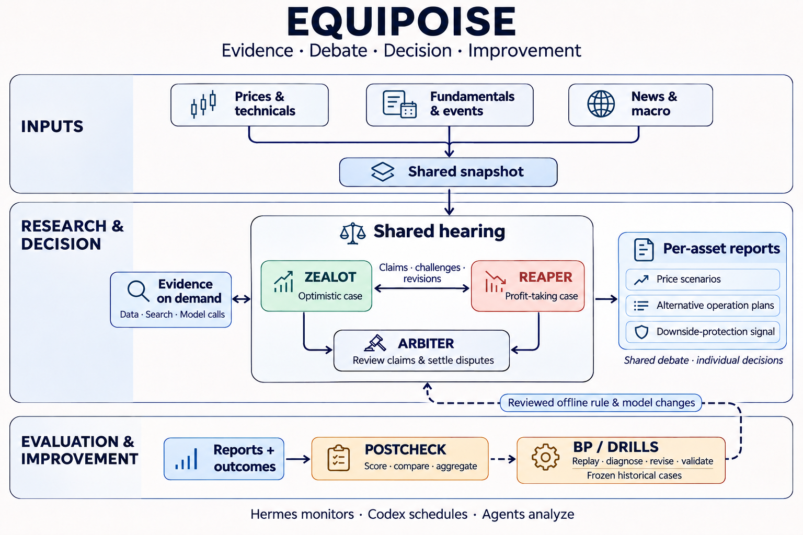
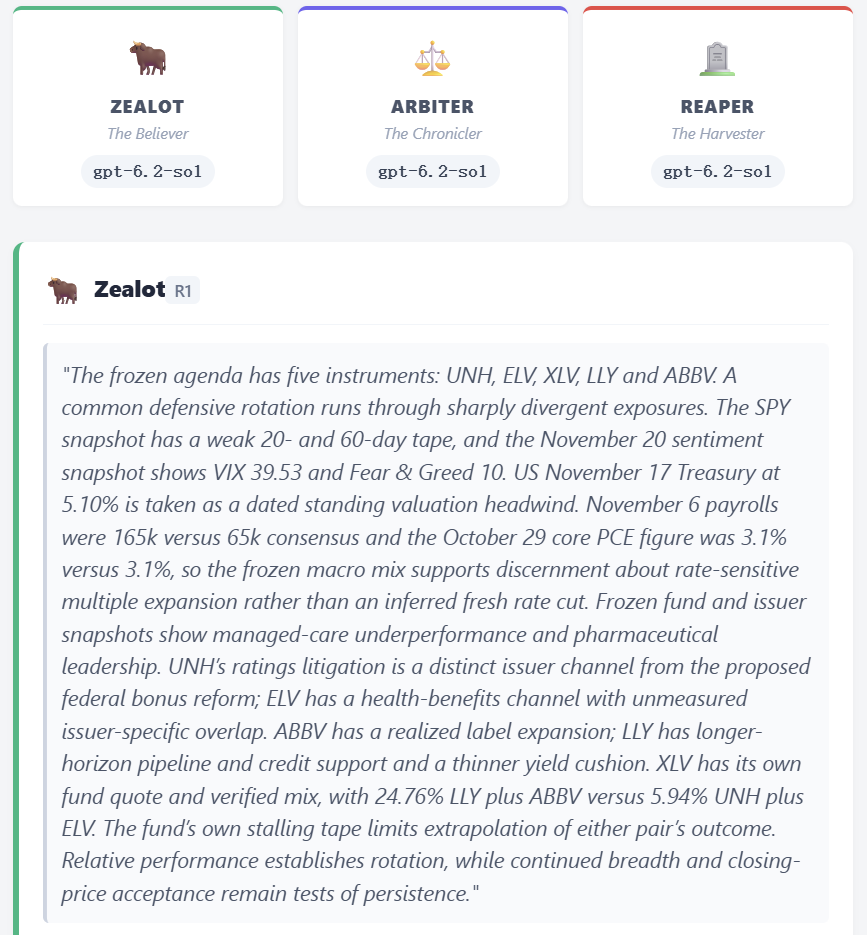

**English** | [**中文**](#中文版)

# ⚖️ Equipoise（均势）

**Market research through evidence, adversarial debate, and reviewed improvement.**

Equipoise is an LLM-based multi-agent framework for quantitative market analysis. Opposing advocates examine the same evidence, challenge each other's reasoning, and submit their claims to an arbiter. The result is an inspectable research record: price scenarios, alternative action plans, and the reasoning behind them.

## How to run

**Setup guide: in preparation.** The current rules, formulas, models, and code are still being prepared for publication. This README describes the current system and its drill plan; the screenshots come from a running private instance. They are not a demonstration of what a fresh clone of this repository can run today.

The available reference implementation is **v1**: see its [setup instructions](README-v1.md) and [frozen code](https://github.com/sst19910323/equipoise_open/tree/v1). It implements an earlier architecture.

The planned entry point is to let **Codex or Claude Code initialize the project**, with guidance for database setup, Hermes (monitoring and agent wake-ups), and worker instances. Those instructions are still being assembled. It has become complicated enough that even getting it organized, initialized, and synchronized is a job for an agent.

## How it works

*A conceptual overview of the current system. A shared hearing produces separate asset reports. The improvement loop represents reviewed changes to rules and models.*

### 1. A shared view of the market

Prices and technical structure, fundamentals and events, news and macro conditions form a shared snapshot. During a hearing, agents can request data, searches, or model calculations to resolve a specific question. Findings are available to both sides, including findings that weaken the requester's case.

**Interactive Brokers (IBKR) is the primary data source in the current setup, supplemented by the agents' own web searches.** IBKR was chosen for its cost-effectiveness, but its legacy client workflow and limited practical concurrency require locks and request queues to keep multiple agents' calls from interfering with each other.

If you have a better-suited data source, ask an agent to adapt the data-access layer to use it, checking the data definitions and request handling as part of the change.

### 2. Opposing cases, accountable judgments

**Zealot** develops the optimistic case. **Reaper** is a profit-taking realist, testing whether the opportunity still justifies its risks. **Arbiter** examines the claims and disputes, then issues a reasoned ruling. Evidence can support a decisive conclusion; agreement or a midpoint is not the goal.

A group of related assets can share a hearing while retaining separate conclusions for each asset and analytical lens. The record keeps the arguments, evidence requests, revisions, and dissent available for inspection.

*Role cards and an opening excerpt from a healthcare-group hearing. [View the captured transcript](images/screenshots/debate-unh-zh.png). Debate text remains in its original English even when the dashboard interface is Chinese.*

### 3. From a judgment to explicit alternatives

Each asset's report connects its reasoning to price scenarios and two alternative plans: a **terminal plan**, evaluated at its target horizon, and a **path-dependent plan**, whose conditions matter along the way. These are alternatives to choose between, not sequential instructions or positions to add together. A separate downside-protection assessment addresses a particular instrument or risk lens.

*An example of how alternatives are expressed. These are research outputs, not automatically placed orders.*

### 4. BP / the drill plan

**BP (a backpropagation analogy) is the system's feedback-and-revision process, organized around drills.** Its purpose is to find where a judgment goes wrong, improve the general rules or models behind it, and test whether the change holds up elsewhere.

Postcheck compares archived reports with subsequent market outcomes at defined windows, including D+3 and D+20. Scores and cross-case statistics help identify patterns worth investigating. Drills can start from those findings or from a selected historical question. The plan follows four steps:

1. **Freeze the case.** Reconstruct the information available at a historical moment, then audit the agents' inputs and evidence replies for later information that should be excluded.
2. **Inspect the reasoning.** Replay the hearing with independent roles; examine what each round sought, established, challenged, or lost. Reviewers build a reference argument from the same historical information and keep it outside the agents' context.
3. **Revise and rerun.** Adjust a general rule or model, then rerun from a clean context. The agents must arrive at their own answer.
4. **Check beyond the case.** Test other dates, market conditions, and held-out cases before accepting a change. Process quality, forecast quality, and action outcomes each need evidence.

The current focus is making this drill process explicit and reproducible. Humans and agents review proposed changes before adoption; BP here concerns the system's rules and models, not neural-network weight training.

### 5. Keeping the research current

**Hermes monitors conditions, wakes agents, and coordinates worker instances.** It checks event schedules and the availability of Interactive Brokers (IBKR), fetches prices through IBKR, and calculates price deviations against stored results. These checks support two main duties:

- At appropriate times, ask **Codex or Claude Code** to update company fundamentals and the broader market's fundamental context.
- At appropriate times, wake **Codex** to run stock analysis. Hermes coordinates multiple Codex instances, preferring the one with the most remaining usage allowance; **Codex makes the final decision about which stocks to run**.

In the current deployment, restarting IBKR requires manual intervention using a phone. While IBKR is unavailable, Hermes pauses wake-ups for stock debates. The public initialization guide for this arrangement is still in preparation.

Browse the [screenshot gallery](docs/screenshots.md) for group dashboards, technicals, fundamentals, macro context, postcheck, and the duty loop.

## Design principles

### Natural layers

Evidence, judgment, plan formulation, evaluation, and scheduling belong in the layers suited to their jobs. Clear responsibilities and interfaces let each layer evolve without absorbing the others.

### Thin yet sturdy

Use a compact set of skills (reusable instruction modules) and remove redundant machinery while aiming to cover market mechanisms and models without leaving important analytical angles out. Simplicity must preserve the analytical capabilities needed across different situations, with gaps actively sought and repaired.

### Symmetric standards

Across every skill, evidence request, and adjudication, competing claims face equivalent standards. All actions—including buying, reducing, holding, waiting, and hedging—must compete fairly on their evidence, without a structural preference for any action. Balance comes from a fair contest, not a forced compromise.

### Reasons and measures

Rules combine plain-language explanations with quantitative formulas or models. Their assumptions and scope make the reference values meaningful and allow justified departures to be examined.

## Further reading

[Design Philosophy](docs/design-philosophy.md) contains the longer reasoning, experiments, and stories behind the design; that public document is also being brought up to date. The [gallery](docs/screenshots.md) shows the current interface, [README-v1](README-v1.md) documents the archived implementation, and [Archive & easter eggs](#easter-eggs) collects earlier milestones.

---

# ⚖️ Equipoise（均势）— 中文

[English](#english) | **中文**

**用证据、对抗辩论与复核改进，组织市场研究。**

Equipoise 是一个基于大语言模型、用于量化市场分析的多智能体框架。持不同立场的辩手面对同一组证据，质疑彼此的推理，再由仲裁者裁定。产出是一份可检查的研究记录：价格情景、备选操作方案，以及支持这些结论的理由。

## 怎么运行

**初始化说明先留个位置，还在整理。** 当前的规则、公式、模型与代码正在准备公开。本文介绍现有系统与演习计划，截图来自正在运行的私有实例，并不代表现在克隆这个仓库就能复现它们。

目前可参考的实现是 **v1**：见 [运行说明](README-v1.md) 和 [冻结代码](https://github.com/sst19910323/equipoise_open/tree/v1)，它采用的是早期架构。

计划中的入口是直接让 **Codex 或 Claude Code 初始化工程**，把数据库、负责监测与唤起的 Hermes 和各个工作实例的配置指引串起来。这部分说明还在整理。项目已经复杂到，连整理、初始化、同步本身，都得请 agent 帮忙了。

## 它怎样工作

*现有系统的概念总览。共享听证产生逐标的报告，改进回路表示经过审阅的规则与模型修订。*

### 1. 共享的市场底图

价格与技术结构、基本面与事件、新闻与宏观环境，组成共享快照。听证过程中，agent 可以围绕具体问题调用数据、检索或模型计算。结果向双方开放，也包括不利于提问者自身论点的结果。

**当前主要数据源是盈透（IBKR），其次是 AI 自己的搜索。** 选择盈透主要是考虑性价比；代价是较老的客户端与接入流程，以及受限的实际并发能力，需要通过锁和请求排队协调多个 agent，避免调用互相卡住。

如果你有更合适的数据源，建议让 agent 修改数据接入层，改接对应来源，并核对数据口径与调用方式。

### 2. 对立的论点，可检查的判断

**Zealot** 构建乐观论点；**Reaper** 是着眼于兑现利润的现实派，检查机会是否仍值得承担风险；**Arbiter** 审查论点与争议，给出有理由的裁决。证据可以支持鲜明的结论，达成一致或取中间值并不是目标。

相关标的可以共享一场听证，同时保留各标的、各分析视角的独立结论。论证、举证请求、判断修订与异议，都留在记录里供检查。

[查看医疗组听证开场节选](images/screenshots/debate-unh-opening.png) · [查看截取的辩论记录](images/screenshots/debate-unh-zh.png)。即使看板界面是中文，辩论仍保留英文原文。

### 3. 把判断表达为明确的备选方案

每个标的的报告把理由连接到价格情景与两套备选方案：**终局型方案**在目标期限上评估，**路径依赖型方案**关心途中条件如何触发行动。两者供择一使用，不是前后步骤，也不应叠加仓位。另有针对特定工具或风险视角的下行保护评估。

[查看双方案卡与下行保护示例](images/screenshots/decision-cards-unh-zh.png)。它们是研究输出，不会据此自动下单。

### 4. BP／演习计划

**BP（借用反向传播的比喻）是围绕演习组织的反馈与修订过程。** 它要找出判断在哪一步出了问题，改进背后的通用规则或模型，再检验改动能否经得起其他案例。

后验复盘（Postcheck）将存档报告与后续市场走势对照，在 D+3、D+20 等窗口打分；跨案例的统计帮助发现值得追查的模式。演习可以从这些发现出发，也可以直接选择一个历史问题。计划分为四步：

1. **冻结案例。** 还原历史时点可获得的材料，再核查辩手输入与举证答复，排除混入的事后信息。
2. **拆开推理。** 由独立角色重演听证，逐回合检查它寻找了什么、确认了什么、反驳了什么，又丢失了什么。评审侧依据同一历史信息建立参考论证，不把它塞进辩手的上下文。
3. **修订重跑。** 修改通用规则或模型，再从干净的上下文重跑；下一次的答案仍由辩手自己得出。
4. **跨案例检验。** 在接受改动前，检查其他日期、市场环境与未参与调试的案例。过程质量、预测质量与操作结果，各自都需要证据。

当前重点是把这套演习流程写清楚、做成可复现的过程。修订由人和 agent 审阅后采纳；这里的 BP 改进的是系统规则与模型，不是训练神经网络权重。

### 5. 让研究持续更新

**Hermes 负责监测、唤起与工作实例协调。** 它查看事件时间表，检查盈透（IBKR）是否在线，通过盈透拉取股价，计算现价相对已有 result 的偏离度。这些检查支撑两项主要职责：

- 在适当时候，喊 **Codex 或 Claude Code** 更新公司与大盘的基本面。
- 在适当时候，喊 **Codex** 起来跑股票。Hermes 协调多个 Codex 实例，优先选择剩余 usage 最多的那个；**最终跑哪些股票，由 Codex 决定**。

当前部署中，重启盈透需要人工通过手机配合。盈透离线期间，Hermes 暂停唤起股票辩论。这套安排的公开初始化说明仍在准备。

[截图画廊](docs/screenshots.md) 展示了分组看板、技术面、基本面、宏观环境、后验复盘与值班调度。

## 设计原则

### 自然成层

证据、判断、方案表达、评估与调度，各自放在适合的层级。职责和接口明确，每层可以演进，不必把其他层的工作揽进来。

### 薄而坚实

用紧凑的一组 skill（可复用的指令模块）减少重复机制，同时尽可能覆盖市场机制与模型的不同侧面。精简必须保留应对不同情境所需的分析能力，并主动寻找、补齐遗漏。

### 对等求衡

所有 skill、举证与裁决都遵循对等的标准。包括买入、减持、持有、等待与对冲在内的所有操作，都要凭证据公平竞争，结构上不偏向任何一种操作。均势来自公平交锋，不要求强行折中。

### 有理有尺

规则由解释与量化公式、模型共同构成。说明适用前提与范围，让参考值有来由，也让有依据的偏离可以被讨论和检查。

## 延伸阅读

更深入的理由、实验与趣闻放在 [设计哲学](docs/design-philosophy.md)，这份公开文档也在继续同步。[截图画廊](docs/screenshots.md) 展示现有界面，[README-v1](README-v1.md) 则记录存档实现。

---

🕰️ Archive & easter eggs / 存档与彩蛋

The project once went by **Apex Quant / Apex Parliament**. It became **Equipoise** in October 2026; the public home is now [sst19910323/equipoise_open](https://github.com/sst19910323/equipoise_open).

项目曾使用 **Apex Quant / Apex Parliament** 的名字，2026 年 10 月更名为 **Equipoise（均势）**。早期三辩手版本与之后的重构，留在这些存档里：

- [v1 send-off / v1 送别](docs/v1-send-off.md)
- [Original paper / 早期论文](https://papers.ssrn.com/abstract=6354961)
- [Design Philosophy / 设计哲学](docs/design-philosophy.md)

**Historical timeline / 历史时间线**

**First drill, November 7–9, 2026 / 首期演习过程图**

These are historical records, not current architecture diagrams. The drill tree includes failed branches and revisions through v3.6; model and deployment labels belong to that experiment.

以上是历史记录，不是当前架构说明。演习图保留了到 v3.6 的失败分支与修订过程，其中的模型和部署标记属于当时的试验。

---

For research and personal use; not investment advice. / 仅供研究与个人使用，不构成投资建议。

[CC BY-NC-SA 4.0](https://creativecommons.org/licenses/by-nc-sa/4.0/) · Non-commercial, attribution, share-alike / 非商业使用、署名、相同方式共享。

Questions and discussion / 交流：**sst19910323@gmail.com**
