

**English** | [**中文**](#中文版)

# ⚖️ Equipoise（均势）

**Strong data. Opposing cases. Evidence that can change either mind.**

Equipoise is an LLM-based framework for quantitative market research. Its judging agents are organized by **stance**: an optimist, a profit-taking realist, and an arbiter. Both advocates work across technicals, fundamentals, events, and macro context, building competing cases from a shared evidence base. The public dashboard follows the chain from **data → events → pricing → action plans**, with the reasoning left open to inspection.

## How to run

**Setup guide: in preparation.** The current rules, formulas, models, and code are still being prepared for publication. This README describes the current system and its drill plan; the screenshots come from a running private instance. They are not a demonstration of what a fresh clone of this repository can run today.

The available reference implementation is **v1**: see its [setup instructions](README-v1.md) and [frozen code](https://github.com/sst19910323/equipoise_open/tree/v1). It implements an earlier architecture.

The planned entry point is to let **Codex or Claude Code initialize the project**, with guidance for database setup, Hermes (monitoring and agent wake-ups), and worker instances. Those instructions are still being assembled. It has become complicated enough that even getting it organized, initialized, and synchronized is a job for an agent.

[Data](#the-data-foundation) · [Debate, tasks & evidence](#the-hearing-debate-tasks-and-evidence) · [Pricing & plans](#from-events-to-prices-and-plans) · [BP / drills](#drill-plan)

## A hearing with a research team

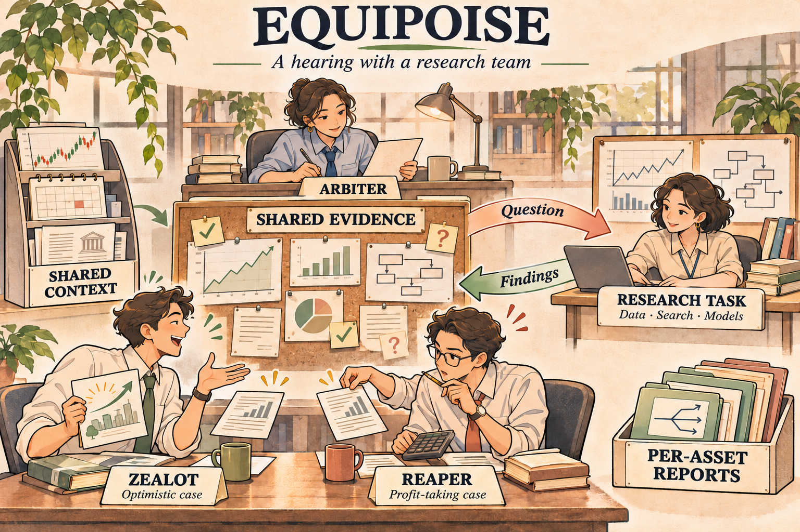

The advocates can argue, but they can also send work out: fetch a missing fact, compare real peers, or run a model workflow. The result comes back into the hearing—even when it helps the other side. A group can share that investigation while each asset receives its own report.

Open the system map

## The data foundation

A debate needs something solid to argue about. The shared snapshot brings together several views of the same market, with dates, units, observation windows, and missing values visible. **Machines calculate the reference quantities; the agents argue about what they mean.**

| View | What it contributes |
| --- | --- |
| Prices and technical structure | Daily, hourly, and intraday lenses; pivots, volatility, trend, relative performance, gaps, and volume events. |
| Company fundamentals and events | Business context, financial-report dates, reporting periods, actual versus expected figures, and upcoming catalysts. |
| Macro and market context | Rates, inflation, employment, sentiment, and volatility, with observation dates and expectations where available. |

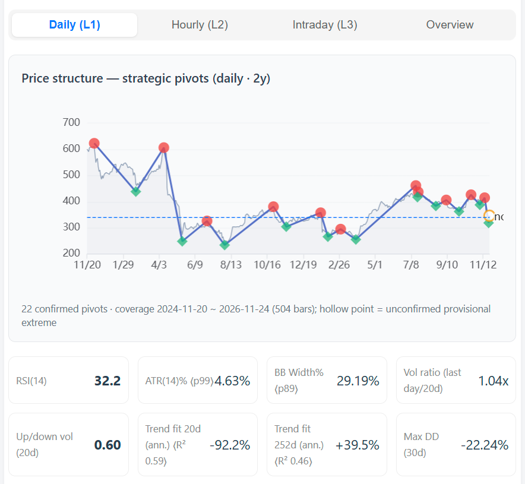

*The technical page exposes the structure behind a judgment. This crop shows the daily lens and its reference quantities. [Full technical page](images/screenshots/technicals-unh-en.png), including explicit unavailable readings.*

<table>
<tr><th>Company fundamentals</th><th>Macro context</th></tr>
<tr>
<td width="50%"><a href="images/screenshots/fundamentals-msft-zh.png">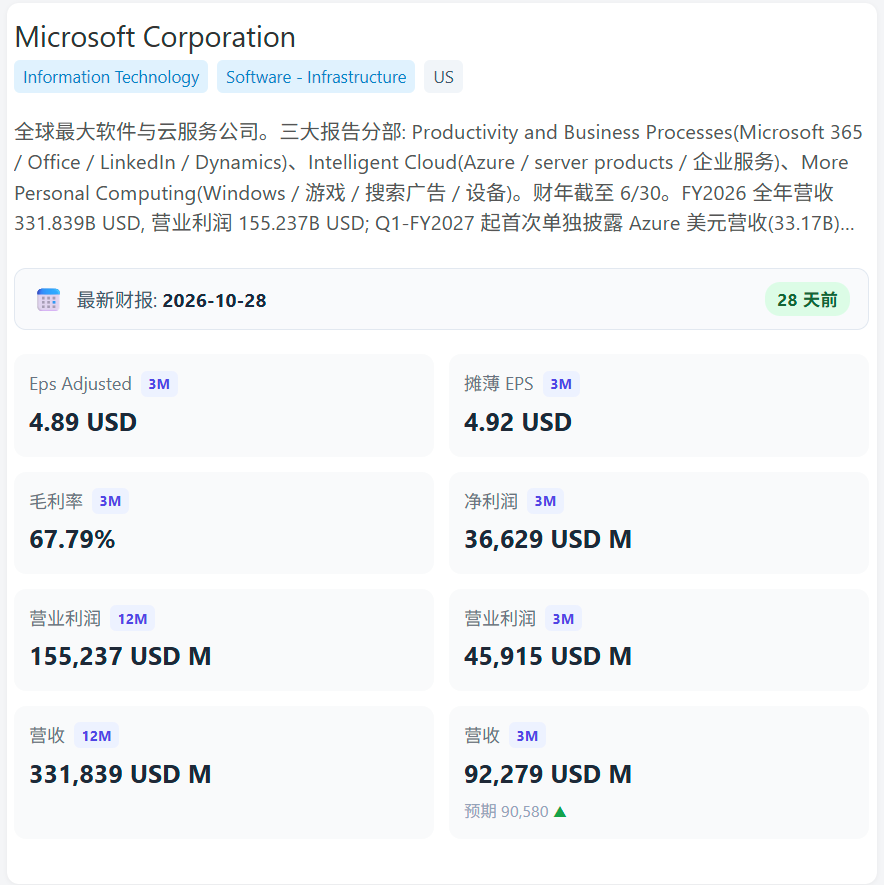</a></td>
<td width="50%"><a href="images/screenshots/macro-us-en.png">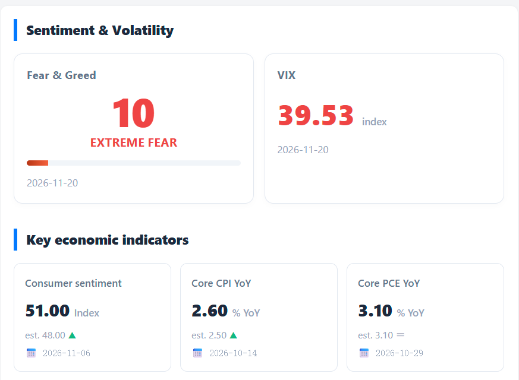</a></td>
</tr>
</table>

*Click either panel to read the full page. The fundamentals capture has a Chinese interface; its periods and units remain visible. The macro crop includes the first row of a larger indicator panel.*

**IBKR is the main data source; the agents' own searches supplement it.** A useful number needs its basis: which company or instrument, which period, which currency, and as of when? Missing or stale observations remain part of the reasoning problem. Source material and findings are archived in PostgreSQL so the record can be inspected beyond a summary or a temporary file path.

If you have a better-suited data source, ask an agent to adapt the data-access layer, checking definitions and request handling as part of the change. The current choice of IBKR reflects its cost-effectiveness; its operational trade-offs are described [below](#keeping-research-current).

## The hearing: debate, tasks and evidence

### Different temperaments, the same burden of proof

| Role | The question it brings to the table |
| --- | --- |
| **Zealot — the optimist** | Where is the upside the market has missed? Build the strongest defensible case for it. |
| **Reaper — the profit-taking realist** | Is this position still worth holding? Examine what is already paid for, what could break, and when to take profit. |
| **Arbiter — the adjudicator** | Which claims survived scrutiny, and what do they imply for the price and the plan? |

Reaper does not have to predict a fall. Arbiter does not have to split the difference. An unsupported extreme and an unsupported compromise are both failures. The discussion must be able to end with a clear lean when the evidence supports one, while preserving the advocates' remaining objections.

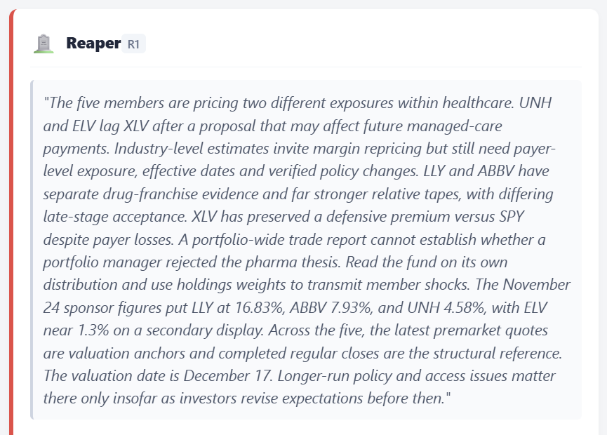

*An actual opening excerpt: one healthcare group, different exposures and arguments for its members. The interface can be Chinese while the debate remains in its original English. [Captured debate page](images/screenshots/debate-unh-zh.png).*

### When “look it up” is not enough

**Debate → a concrete question → research work → evidence → a revised argument.** A task is a way to do the work behind a claim. Naming a model is not running it.

| Need | Research route |
| --- | --- |
| A quantitative comparison or missing market observation | A **data call** retrieves or calculates the relevant observations. |
| A disputed fact, policy detail, or explanation of an event | An **evidence search** follows sources and checks what they actually establish. |
| New material plus a multi-step method, or a dispute about the method itself | A **model task** executes the relevant workflow and returns numbered findings. |

A simple lookup stays simple. A larger task should state the issue it is meant to settle and what result would change the case. Its executor works neutrally; the returned finding may support, refute, or only partly support the requester's claim. Findings are shared, with source references and a stated verification scope. “Not found” and “the call failed” are different outcomes. A factual detail can be checked; a forecast still has to be argued.

> **Illustrative exchange—not a recorded run.** Reaper attributes a rally to the sector; Zealot claims company-specific strength. A price lookup alone cannot settle the disagreement. A task selects comparable peers, aligns the observation windows, and examines relative performance. Suppose it finds both a sector component and a residual: neither advocate gets to turn that partial result into a complete victory. The residual is a clue for further investigation, not proof of a particular cause. Arbiter revises only the claims the evidence actually bears on.

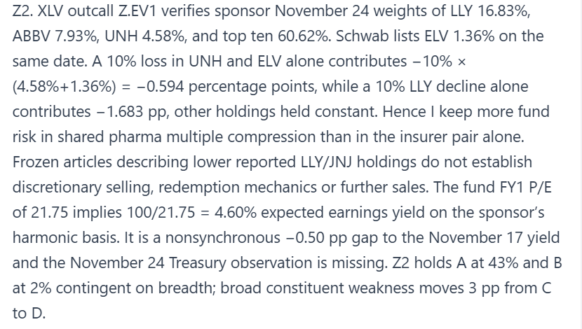

*A separate passage from Zealot's opening cites evidence `Z.EV1`, uses holdings in a calculation, and states missing observations and limits. It shows evidence entering an argument; it is not a screenshot of a complete request-and-response sequence. [Opening and role cards](images/screenshots/debate-unh-opening.png) · [Captured transcript](images/screenshots/debate-unh-zh.png).*

## From events to prices and plans

“Good news” is the start of a question. **What changed relative to expectations, and how much was already in the price?** The agents connect facts to a transmission mechanism, consider the uncertainty and time horizon, and express the result as price scenarios. Repeating an already-accounted-for fact should not manufacture another catalyst; winning a rhetorical point earns no price move by itself.

> **Illustrative case—not a recorded run.** A company raises its guidance. The shared material aligns the new guidance with the earlier forecast, reporting basis, pre-event move, and sector context. Zealot argues that expectations still have room to rise; Reaper asks whether the market has already paid for that improvement. The prior rally alone does not settle the issue. The useful work is identifying what is new, how it reaches earnings or valuation, and what would invalidate the interpretation.

Each asset's report then connects its scenarios to two **alternative** plans:

- **Terminal:** evaluate the position at its target horizon.
- **Path-dependent:** specify the conditions along the way that would change the action.

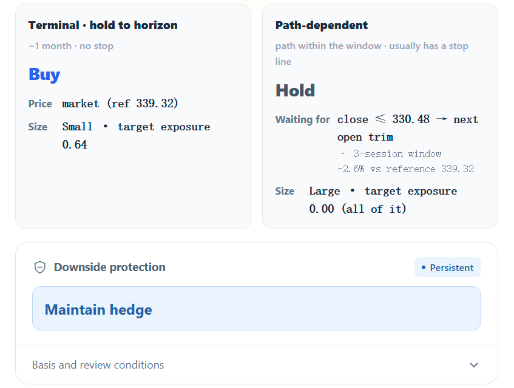

*Choose between the two plans; they are not sequential steps or positions to add together. Downside protection is assessed for its own instrument or risk lens. These are research outputs, not automatically placed orders.*

**Holding and waiting are operations too.** They need reasons, a time or condition to revisit, and an account of what happens if the hoped-for change never arrives.

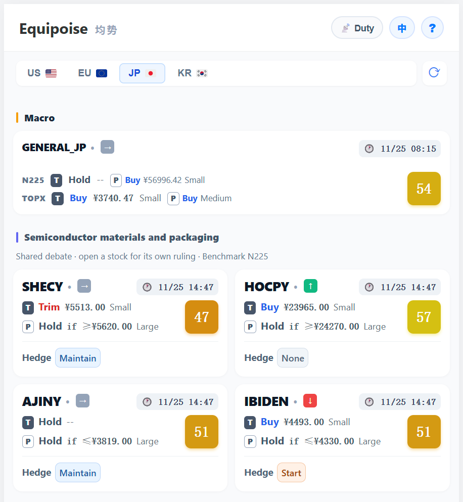

*One group can share its debate and evidence while its assets receive different conclusions. [Full dashboard](images/screenshots/dashboard-japan-en.png) · [Full report](images/screenshots/verdict-unh-en.png).*

## BP / drills: inspect the judgment, improve the method

**BP (a backpropagation analogy) is the feedback-and-revision process, organized around drills.** A final score can show that a call went wrong; the transcript can reveal where the reasoning lost its footing. Finding a risk, responding proportionately to a rebuttal, and preserving a justified conclusion are different abilities.

Postcheck measures archived calls against later outcomes at windows including D+3 and D+20. Drills investigate the process behind them, or start from a historical question of their own. Live searches cannot simply be rewound with the price chart: the plan requires reconstructing and checking what was knowable at the time.

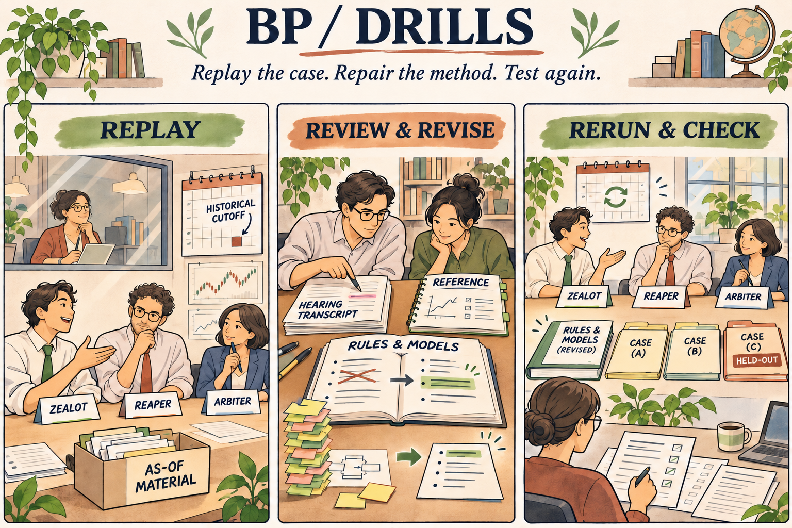

1. **Freeze and inspect the inputs.** Reconstruct historical material and audit the agents' inputs and evidence replies for later information that should be excluded.
2. **Replay the reasoning.** Independent roles work through the hearing. Reviewers compare each round with a defensible reference argument built from contemporaneous information; that reference stays outside the roles' context.
3. **Revise the general mechanism.** Change the rule or model behind the failure, then rerun from a clean context. The agents must produce their own answer.
4. **Check other cases.** Test other dates, market conditions, and held-out cases before accepting the change. Process quality, forecast quality, and action outcomes each need evidence.

**Drills locate a failure; statistics check whether it recurs.** Humans and agents review changes before adoption. The current focus is making this process explicit and reproducible; it revises system rules and models rather than training neural-network weights.

What a postcheck looks like: one D+3 example

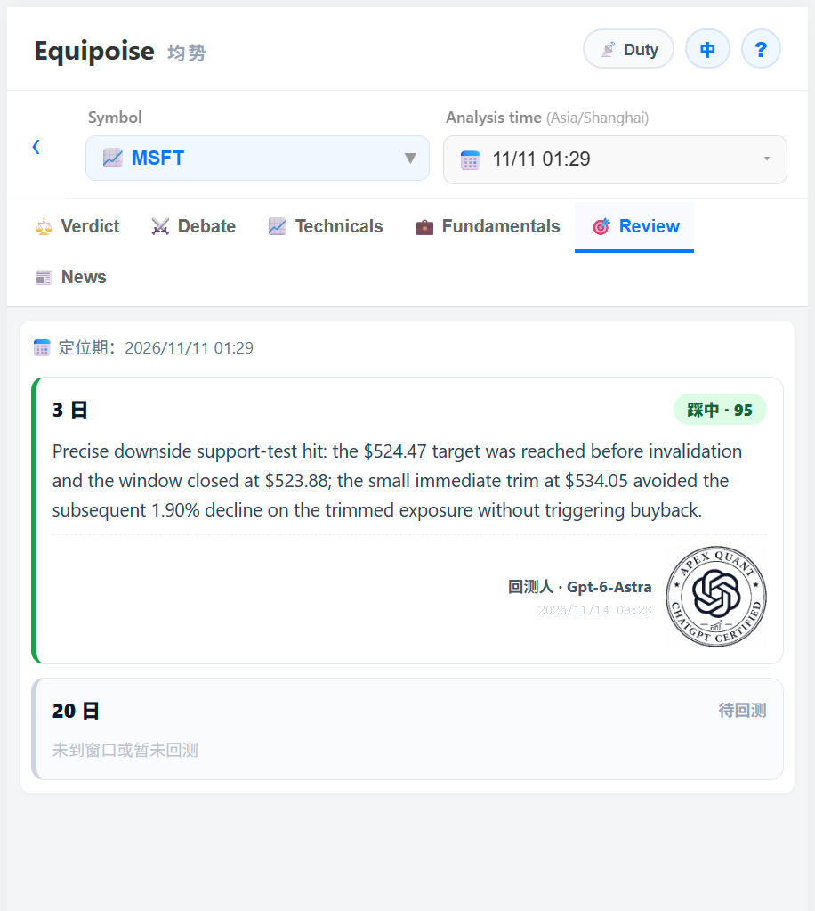

This capture shows the review format for one case, with D+20 still pending. It is not an aggregate performance result.

## Keeping research current

**Hermes monitors conditions, wakes agents, and coordinates worker instances.** It checks event schedules and IBKR availability, fetches prices, and calculates deviations against stored results. Its two main duties are:

- Wake **Codex or Claude Code** when company or broader-market fundamentals need refreshing.
- Wake **Codex** for stock research, coordinating multiple eligible instances and preferring the one with the most remaining usage allowance. **Codex makes the final decision about which stocks to run.**

The current IBKR integration has an older client workflow and limited practical concurrency; locks and request queues keep calls from interfering. Restarting IBKR currently needs manual phone-assisted intervention. While it is unavailable, Hermes pauses stock-debate wake-ups.

Worker capacity and the duty loop

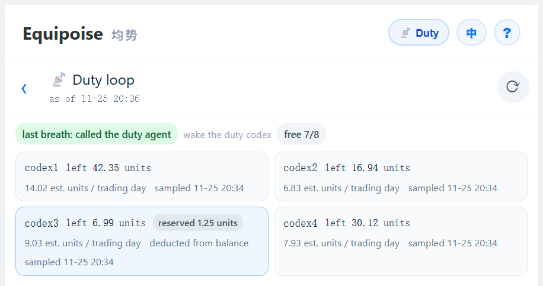

[Full duty view](images/screenshots/duty-loop-en.png). Public initialization for this arrangement is still being organized.

## Beyond the dashboard: personal portfolio planning

The public dashboard provides neutral research across **data → events → pricing → action plans**. Turning those outputs into a personal rebalancing plan requires another layer that accounts for each person's holdings and circumstances. As the watchlist approaches 100 assets, even reading every final report becomes difficult for one person.

A separate portfolio layer is therefore being explored: a capable AI would read holdings and research reports, use the reports as high-confidence inputs, and propose portfolio adjustments. This design assumes the reports are sufficiently reliable. The longer-term direction is to progress from discussing plans with the AI, through systematic execution of agreed plans, toward AI-driven execution.

**Parts of this layer have already been designed in the main project, but the design is still immature and depends on private server URLs and interfaces. It is not being published at present.** This section only introduces the plan; personal rebalancing and automated execution are outside the current public release.

## Design principles

### Natural layers

Evidence, judgment, plan formulation, evaluation, and scheduling belong in the layers suited to their jobs. Clear responsibilities and interfaces let each layer evolve without absorbing the others.

### Thin yet sturdy

Use a compact set of skills (reusable instruction modules) and remove redundant machinery while aiming to cover market mechanisms and models without leaving important analytical angles out. Simplicity must preserve the analytical capabilities needed across different situations, with gaps actively sought and repaired.

### Symmetric standards

Across every skill, evidence request, and adjudication, competing claims face equivalent standards. All actions—including buying, reducing, holding, waiting, and hedging—must compete fairly on their evidence, without a structural preference for any action. Balance comes from a fair contest, not a forced compromise. Holding is an operation, not an exemption.

### Reasons and measures

Rules combine plain-language explanations with quantitative formulas or models. Their assumptions and scope make the reference values meaningful and allow justified departures to be examined. A threshold is an anchor with a reason, not a switch to obey blindly.

## Further reading

[Design Philosophy](docs/design-philosophy.md) contains the longer reasoning, experiments, and stories behind the design; that public document is also being brought up to date. The [gallery](docs/screenshots.md) shows the current interface, [README-v1](README-v1.md) documents the archived implementation, and [Archive & easter eggs](#easter-eggs) collects earlier milestones.

---

# ⚖️ Equipoise（均势）— 中文

[English](#english) | **中文**

**扎实的数据，对立的论点，能让双方改变看法的证据。**

Equipoise 是一个基于大语言模型的量化市场研究框架。参与判断的 agent 按**立场**组织：乐观者、着眼于兑现利润的现实派，以及仲裁者。两位辩手都要跨技术面、基本面、事件与宏观环境，在共享证据上建立各自的论点。公共看板贯穿 **数据 → 事件 → 定价 → 操作方案**，也把形成判断的过程留下来供检查。

## 怎么运行

**初始化说明先留个位置，还在整理。** 当前的规则、公式、模型与代码正在准备公开。本文介绍现有系统与演习计划，截图来自正在运行的私有实例，并不代表现在克隆这个仓库就能复现它们。

目前可参考的实现是 **v1**：见 [运行说明](README-v1.md) 和 [冻结代码](https://github.com/sst19910323/equipoise_open/tree/v1)，它采用的是早期架构。

计划中的入口是直接让 **Codex 或 Claude Code 初始化工程**，把数据库、负责监测与唤起的 Hermes 和各个工作实例的配置指引串起来。这部分说明还在整理。项目已经复杂到，连整理、初始化、同步本身，都得请 agent 帮忙了。

[数据底座](#数据底座) · [辩论任务与证据](#听证辩论任务与证据) · [事件到定价](#从事件到定价再到操作) · [BP／演习](#drill-plan-zh)

## 一场带着研究团队的听证

辩手可以争论，也可以把工作发出去：查缺失的事实、比较真正的同业、执行一套模型流程。结果回到听证桌上，即使它帮了对手。一组标的可以共享这场研究，同时各自得到独立报告。

展开系统结构图

## 数据底座

辩论总得有些扎实的东西可争。共享快照把同一市场的不同侧面摆在一起，也保留日期、单位、观察窗口与缺失值。**机器计算参考量，agent 讨论这些量意味着什么。**

| 视角 | 提供什么 |
| --- | --- |
| 价格与技术结构 | 日线、小时、盘中三个镜头；拐点、波动、趋势、相对表现、缺口与放量事件。 |
| 公司基本面与事件 | 业务背景、财报日期、报告期、实际值与预期值，以及后续催化因素。 |
| 宏观与市场环境 | 利率、通胀、就业、情绪与波动率，附观察日期和可获得的预期值。 |

*技术页把判断背后的结构摊开。此处展示日线镜头与参考量；[完整中文技术页](images/screenshots/technicals-unh-zh.png)也保留了不可用读数的标记。*

<table>
<tr><th>公司基本面</th><th>宏观环境</th></tr>
<tr>
<td width="50%"></td>
<td width="50%"></td>
</tr>
</table>

*点击面板查看完整页面。基本面保留报告期与单位；宏观节选展示情绪卡和经济指标的首行。*

**当前主要数据源是盈透（IBKR），其次是 AI 自己的搜索。** 一个数字要有口径：哪个标的、哪个期间、什么币种、截至何时？数据缺失或过时，也必须留在推理问题里。实际使用的来源材料与取证结果归档到 PostgreSQL，让记录能够追溯到摘要和临时文件路径之外。

如果你有更合适的数据源，建议让 agent 修改接入层，并核对数据口径与调用方式。选择盈透主要考虑性价比；当前接入的运行限制放在[持续更新](#让研究持续更新)一节说明。

## 听证：辩论、任务与证据

### 性格不同，举证要求对等

| 角色 | 带到桌上的问题 |
| --- | --- |
| **Zealot——乐观者** | 市场还有哪些上行空间没看见？把有依据的乐观论点建立起来。 |
| **Reaper——着眼于兑现利润的现实派** | 这个仓位还值得拿吗？检查已经透支了什么、哪里可能出问题，以及何时该兑现。 |
| **Arbiter——仲裁者** | 哪些论点经受住了检查，它们对价格与方案意味着什么？ |

Reaper 不必预测下跌，Arbiter 也不必各打五十大板。没有依据的极端与没有依据的折中，同样会出错。证据支持时，讨论应当能够形成鲜明的倾向，同时留下辩手仍然坚持的异议。

*真实发言节选：同属一个医疗组，各标的却有不同的风险暴露与论点。中文界面里，辩论仍保留英文原文。[查看截取的辩论页](images/screenshots/debate-unh-zh.png)。*

### “查一下”不够时，就把任务做出来

**辩论 → 具体问题 → 研究任务 → 证据 → 修订论点。** Task 是把论点背后的工作做出来。喊出模型名字，还不等于运行过模型。

| 需要什么 | 对应的研究途径 |
| --- | --- |
| 一项量化比较，或缺失的市场观察 | **数据调用**，获取或计算相关观察量。 |
| 有争议的事实、政策细节或事件解释 | **证据检索**，沿来源检查它究竟说明了什么。 |
| 新材料加多步骤方法，或双方对方法本身有争议 | **模型任务**，执行相应流程，带回有编号的结果。 |

简单查询不必套上大任务。较复杂的任务要说明针对哪个争点、什么结果会改变判断。执行者中立开展工作，结果可能支持、反驳，也可能只支持提问者的一部分论点。发现向双方公开，并附来源与查证范围。“没找到”和“调用失败”分别记录；事实细节可以核查，预测仍然需要论证。

> **概念示意，非实际运行记录。** Reaper 认为一轮上涨来自板块，Zealot 主张公司自身更强。查一个涨幅无法解决分歧，于是任务要选择可比同业、对齐观察窗口，再检查相对表现。假设结果同时包含板块成分和剩余差异，双方都不能把“部分”说成“全部”；剩余差异也是进一步调查的线索，不足以单独证明某种原因。Arbiter 只修订证据真正涉及的论点。

*另一处 Zealot 开场节选：引用 `Z.EV1`，用持仓权重展开计算，并说明缺失观察与解释边界。这里展示证据进入论点，不是完整的请求与回执截图。[开场与角色卡](images/screenshots/debate-unh-opening.png) · [截取的辩论记录](images/screenshots/debate-unh-zh.png)。*

## 从事件到定价，再到操作

“利好”只是一个问题的开头：**相对预期究竟变了什么，市场已经计入了多少？** 辩手要把事实接到传导机制上，考虑不确定性与时间范围，再表达成价格情景。重复已经计入的事实，不该平白再制造一轮催化；在口头交锋里占上风，也不会凭空多出一段价格空间。

> **概念示意，非实际运行记录。** 一家公司上调指引。共享材料先把新指引、原有预期、报告口径、事件前走势与行业背景对齐。Zealot 认为预期还有上修空间，Reaper 追问市场是否早已为这种改善付过钱。此前涨过，并不能独自回答这个问题；真正要查的是新增了什么、怎样传导到盈利或估值，以及什么证据会推翻当前解释。

每个标的的报告，再把情景连接到两套**备选**方案：

- **终局型**：在目标期限上评估仓位。
- **路径依赖型**：说明途中哪些条件会改变行动。

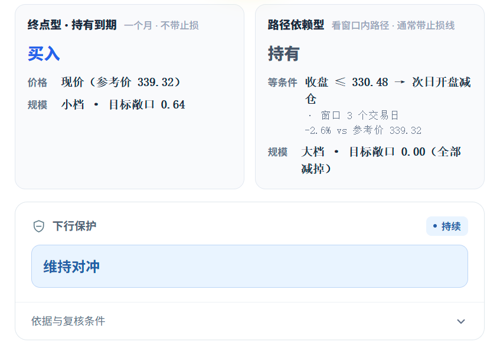

*两套方案供择一使用，不是前后步骤，也不叠加仓位。下行保护按自己的工具或风险视角评估。这些都是研究输出，不会据此自动下单。*

**持有与等待也是操作。** 同样需要理由、复查的时间或条件，以及“等不来怎么办”的安排。

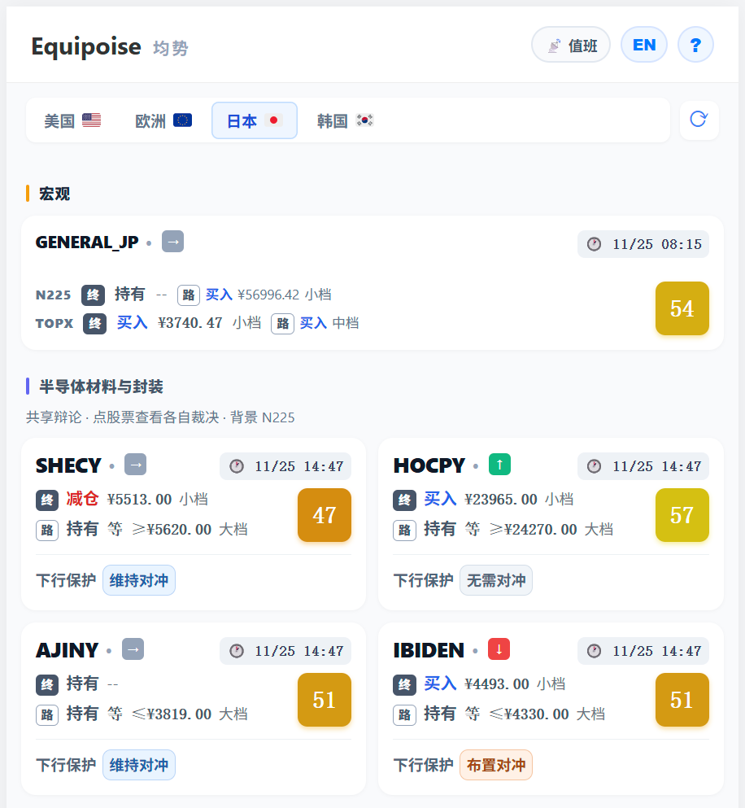

*同组共享辩论与证据，各标的可以得到不同结论。[完整看板](images/screenshots/dashboard-japan-zh.png) · [报告节选](images/screenshots/verdict-unh-zh.png)。*

## BP／演习：拆开判断，改进方法

**BP（借用反向传播的比喻）是围绕演习组织的反馈与修订过程。** 一个总分能显示判断出了问题，逐回合记录则能帮助找到推理在哪里失足。发现风险、对反驳作出适度反应、保住仍有依据的结论，是不同的能力。

后验复盘（Postcheck）在 D+3、D+20 等窗口，将存档判断与之后的结果对照。演习追查背后的过程，也可以从独立选择的历史问题出发。实时搜索无法像价格图一样直接倒带，因此计划必须包含对当时信息边界的还原与核查。

1. **冻结并检查输入。** 还原历史材料，核查辩手输入与举证答复，排除混入的事后信息。
2. **重演推理。** 独立角色逐回合开展听证；评审依据当时信息建立有根据的参考论证，逐轮对照。参考论证留在评审侧，不进入辩手上下文。
3. **修订通用机制。** 改动问题背后的规则或模型，再从干净上下文重跑；下一次答案仍由辩手自己得出。
4. **检查其他案例。** 接受改动前，检验其他日期、市场环境与未参与调试的案例。过程质量、预测质量与操作结果，各自需要证据。

**演习找病灶，统计查它是不是常见病。** 修订经过人和 agent 审阅后采纳。当前重点是把过程写清楚、做成可复现的流程；改进对象是系统规则与模型，不是神经网络权重训练。

后验复盘长什么样：一个 D+3 案例

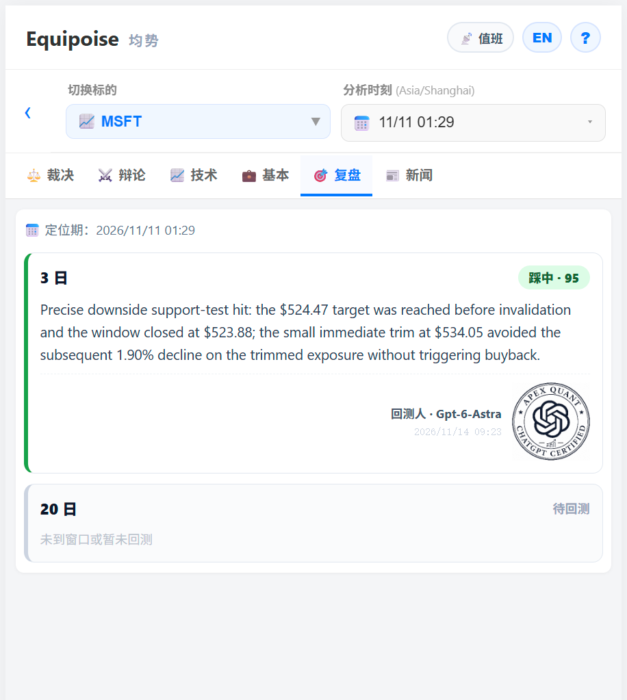

这张截图展示单个案例的复盘格式，D+20 尚待完成，不代表整体表现统计。

## 让研究持续更新

**Hermes 负责监测、唤起与工作实例协调。** 它查看事件时间表与盈透在线状态，拉取股价，计算相对已有 result 的偏离度，支撑两项主要职责：

- 公司与大盘基本面需要刷新时，唤起 **Codex 或 Claude Code**。
- 需要跑股票时，唤起 **Codex**，协调多个可用实例，优先选择剩余 usage 最多的那个。**最终跑哪些股票，由 Codex 决定。**

当前盈透接入的客户端流程较老，实际并发能力受限，需要锁与请求排队来避免互相卡住。重启盈透目前需要人工通过手机配合；离线期间，Hermes 暂停唤起股票辩论。

工作实例容量与值班循环

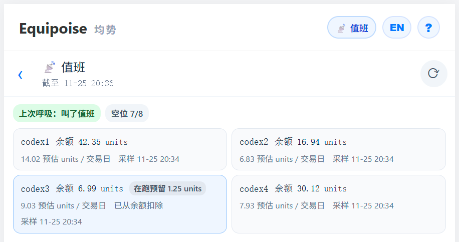

[完整值班视图](images/screenshots/duty-loop-zh.png)。这部分公开初始化说明仍在整理。

## 看板之外：个人调仓计划

公共看板提供中立研究，覆盖 **数据 → 事件 → 定价 → 操作方案**。具体到每个人如何调仓，还需要结合各自持仓与实际情况的另一层。随着关注标的接近 100 个，连逐份阅读最终报告，对一个人来说都开始吃力。

因此，另一个正在探索的方向，是让能力更强的 AI 同时读取持仓与研究报告，将报告作为高可信输入，提出组合层面的调整建议。这一设计以报告足够可靠为前提，长期方向是从与 AI 讨论方案，逐步走向按认可的计划机械执行，再进一步探索 AI 自动执行。

**主工程已经有这一层的部分设计，但目前尚不成熟，也涉及私有服务器 URL 与接口，因此暂不公开。** 这里仅介绍这项计划；个人调仓与自动执行均不属于当前公开版本的交付范围。

## 设计原则

### 自然成层

证据、判断、方案表达、评估与调度，各自放在适合的层级。职责和接口明确，每层可以演进，不必把其他层的工作揽进来。

### 薄而坚实

用紧凑的一组 skill（可复用的指令模块）减少重复机制，同时尽可能覆盖市场机制与模型的不同侧面。精简必须保留应对不同情境所需的分析能力，并主动寻找、补齐遗漏。

### 对等求衡

所有 skill、举证与裁决都遵循对等的标准。包括买入、减持、持有、等待与对冲在内的所有操作，都要凭证据公平竞争，结构上不偏向任何一种操作。均势来自公平交锋，不要求强行折中；持有是一种操作，不是一张豁免券。

### 有理有尺

规则由解释与量化公式、模型共同构成。说明适用前提与范围，让参考值有来由，也让有依据的偏离可以被讨论和检查。阈值是带理由的锚点，不是盲从的开关。

## 延伸阅读

更深入的理由、实验与趣闻放在 [设计哲学](docs/design-philosophy.md)，这份公开文档也在继续同步。[截图画廊](docs/screenshots.md) 展示现有界面，[README-v1](README-v1.md) 则记录存档实现。

---

🦾 Signed, with reservations / 保留意见，也要盖章

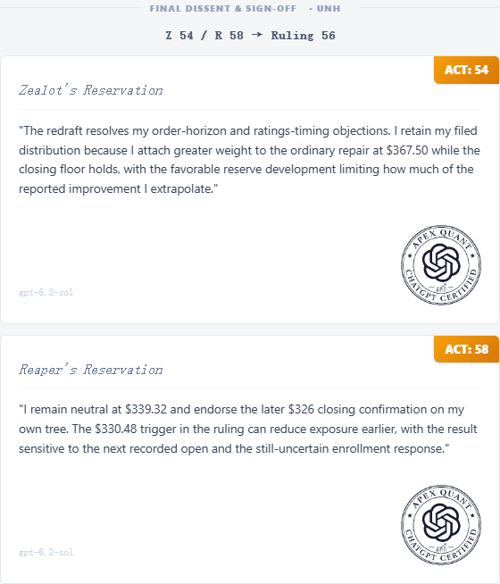

The hearing closes; the objections stay on the record. Even the agents have a little paperwork. These playful in-project seals still carry the old **Apex Quant** name; they are not an external certification.

听证收场，保留意见继续留档。赛博同事也有自己的盖章环节。这些项目内的趣味印章还保留着 **Apex Quant** 旧名，并非外部认证。

🕰️ Archive & easter eggs / 存档与彩蛋

The project once went by **Apex Quant / Apex Parliament**. It became **Equipoise** in October 2026; the public home is now [sst19910323/equipoise_open](https://github.com/sst19910323/equipoise_open).

项目曾使用 **Apex Quant / Apex Parliament** 的名字，2026 年 10 月更名为 **Equipoise（均势）**。早期三辩手版本与之后的重构，留在这些存档里：

- [v1 send-off / v1 送别](docs/v1-send-off.md)
- [Original paper / 早期论文](https://papers.ssrn.com/abstract=6354961)
- [Design Philosophy / 设计哲学](docs/design-philosophy.md)

**Historical timeline / 历史时间线**

**First drill, November 7–9, 2026 / 首期演习过程图**

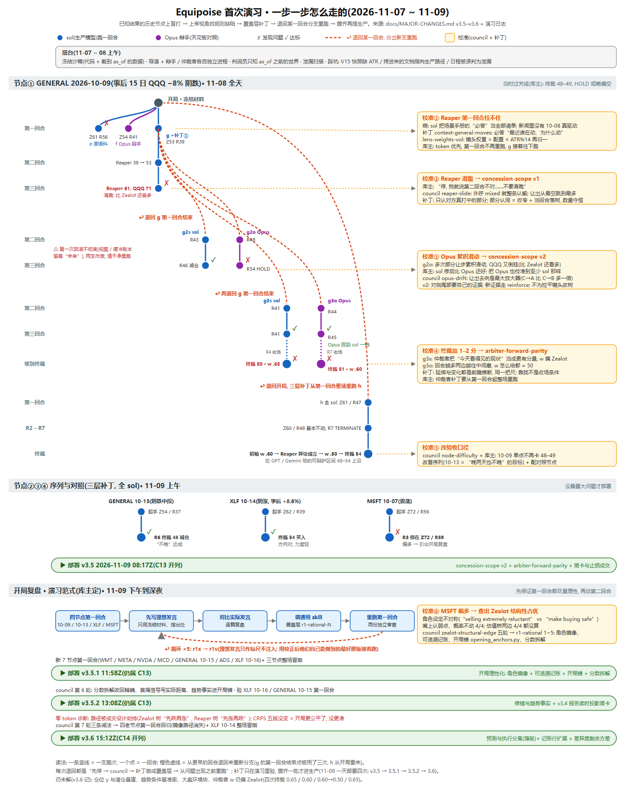

These are historical records, not current architecture diagrams. The drill tree includes failed branches and revisions through v3.6; model and deployment labels belong to that experiment.

以上是历史记录，不是当前架构说明。演习图保留了到 v3.6 的失败分支与修订过程，其中的模型和部署标记属于当时的试验。

---

For research and personal use; not investment advice. / 仅供研究与个人使用，不构成投资建议。

[CC BY-NC-SA 4.0](https://creativecommons.org/licenses/by-nc-sa/4.0/) · Non-commercial, attribution, share-alike / 非商业使用、署名、相同方式共享。

Questions and discussion / 交流：**sst19910323@gmail.com**
