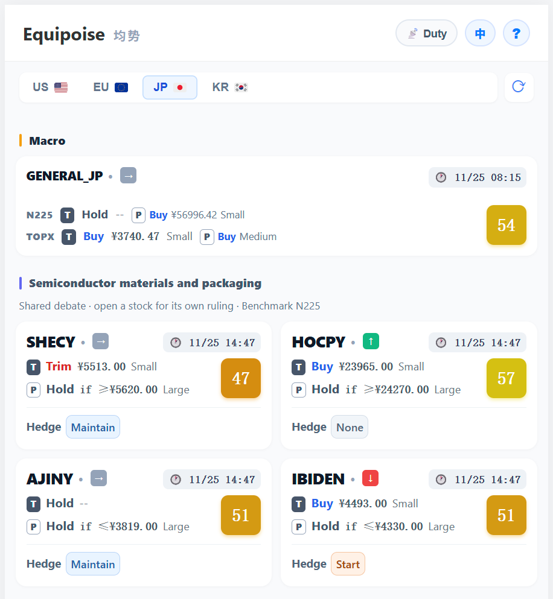
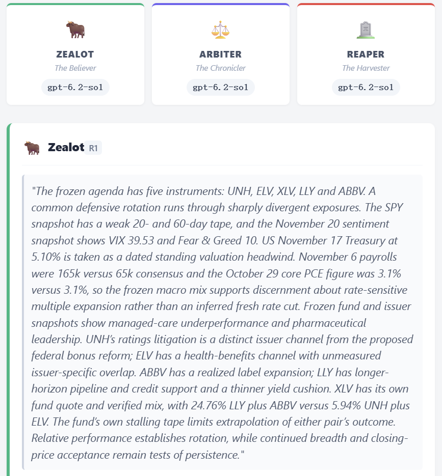
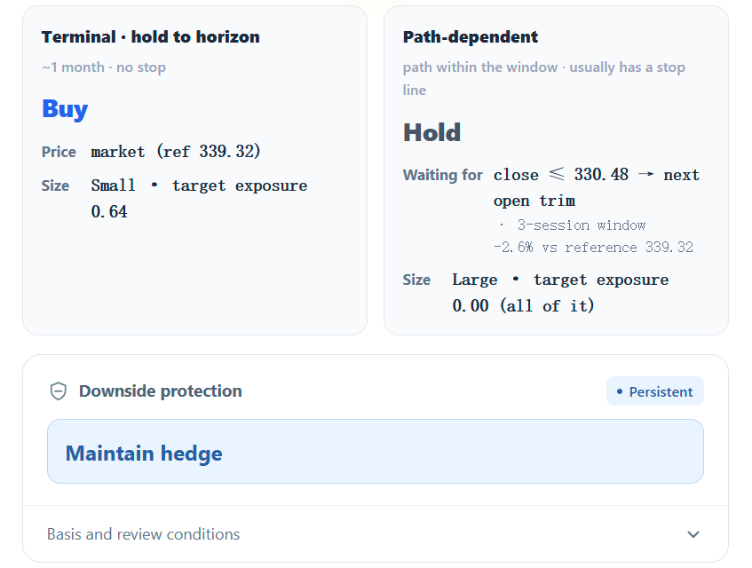
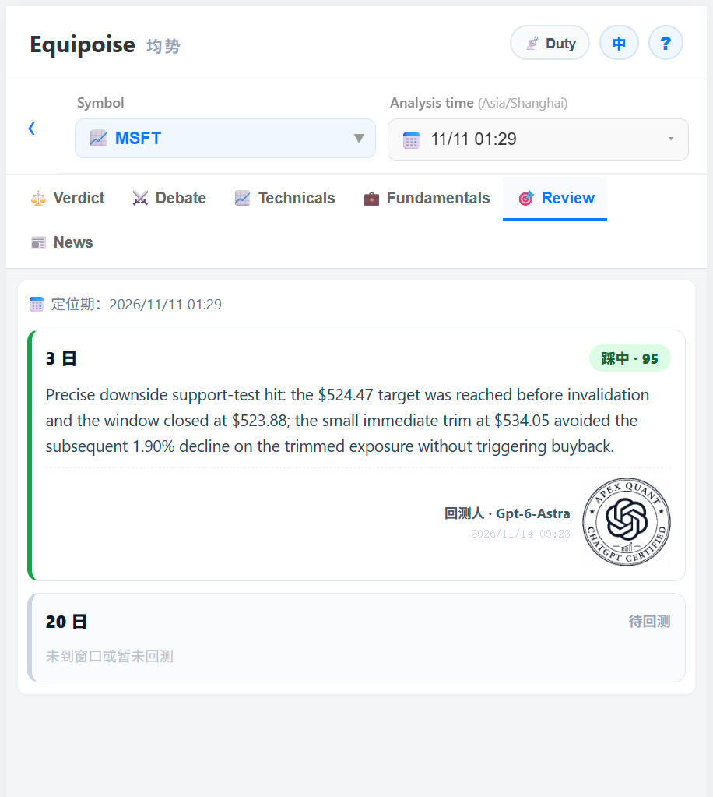
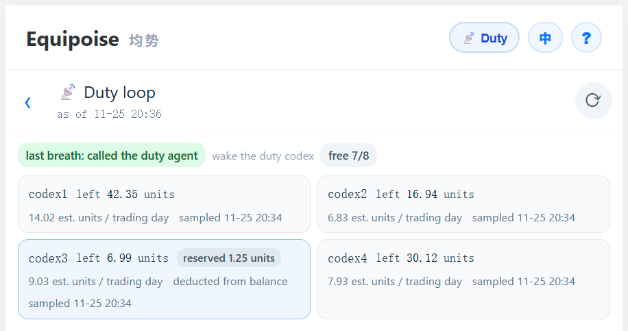

# Equipoise in use / 界面示例

These screenshots come from the running private edition. The current code and setup guide are still being prepared for publication; see [How to run](../README.md#how-to-run). Images have been renamed and cropped locally without changing the pixels retained inside each crop. Captures illustrate the interface, not aggregate performance.

截图来自运行中的私有版本；当前代码与初始化说明仍在整理，见 [怎么运行](../README.md#怎么运行)。图片经过重命名与本地无损裁剪，保留区域内的文字、数字与图表像素未改动。它们用于展示界面，不代表整体业绩。

## Shared hearing, separate asset reports / 共享听证，逐标的报告

Related assets share a hearing while retaining their own reports. / 相关标的共享听证，各自保留报告。

[English dashboard](../images/screenshots/dashboard-japan-en.png) · [中文看板](../images/screenshots/dashboard-japan-zh.png)

## The reasoning record / 推理记录

Role cards and an excerpt from the opening statement, not a complete round. The captured transcript uses a Chinese interface with original English debate text. / 角色卡与开场发言节选，不是完整回合；截取的记录采用中文界面，辩论保留英文原文。

[Captured transcript / 截取的辩论记录](../images/screenshots/debate-unh-zh.png)

The README also shows [Reaper's opening paragraph](../images/screenshots/debate-reaper-opening-en.png) and [a numbered evidence citation in Zealot's argument](../images/screenshots/debate-evidence-citation-en.png). These are separate excerpts from the same shared hearing; the long capture stops partway through the debate. / README 另展示 [Reaper 的开场段落](../images/screenshots/debate-reaper-opening-en.png)与 [Zealot 论点中的编号证据引用](../images/screenshots/debate-evidence-citation-en.png)。它们是同场听证的不同节选，长截图在辩论中途结束。

## Alternative plans / 备选方案

Terminal and path-dependent plans are alternatives, not sequential steps or combined positions. Downside protection is assessed for its own instrument or risk lens. / 终局型与路径依赖型方案供择一使用，不是前后步骤，也不叠加仓位；下行保护按其工具或风险视角单独评估。

[English report](../images/screenshots/verdict-unh-en.png) · [中文报告节选](../images/screenshots/verdict-unh-zh.png) · [中文方案卡](../images/screenshots/decision-cards-unh-zh.png)

## Evidence panels / 证据面板

| View / 视图 | English | 中文 |
| --- | --- | --- |
| Technicals / 技术面 | [UNH](../images/screenshots/technicals-unh-en.png) | [UNH](../images/screenshots/technicals-unh-zh.png) |
| Macro / 宏观 | [US](../images/screenshots/macro-us-en.png) | [美国](../images/screenshots/macro-us-zh.png) |
| Fundamentals / 基本面 | — | [MSFT](../images/screenshots/fundamentals-msft-zh.png) |

Compact panels used in the README: [technicals](../images/screenshots/data-technicals-unh-en.png), [fundamentals](../images/screenshots/data-fundamentals-msft-zh.png), [macro](../images/screenshots/data-macro-us-en.png). / 正文使用了保留原始像素的技术结构、基本面与宏观面板裁片。

## Postcheck / 后验复盘

One archived report at its review windows / 一份存档报告的复盘窗口

This is one case: its D+3 review is available and D+20 is still pending in the capture. It is not a win rate or an aggregate performance result. Some internal labels remain Chinese in the English interface. / 这是单个案例：截图中 D+3 已复盘、D+20 尚待完成，不是胜率或整体表现统计。英文界面中部分内部标签仍是中文。

[中文复盘](../images/screenshots/postcheck-msft-zh.png)

## Duty loop / 值班调度

Hermes wakes Codex or Claude Code to refresh company and broader-market fundamentals, and wakes Codex for stock analysis. It coordinates Codex instances by remaining usage allowance; Codex decides which stocks to run. / Hermes 适时唤起 Codex 或 Claude Code 更新公司与大盘基本面，并唤起 Codex 跑股票；它按剩余 usage 协调 Codex 实例，最终跑哪些股票由 Codex 决定。

[English duty view](../images/screenshots/duty-loop-en.png) · [中文值班视图](../images/screenshots/duty-loop-zh.png)

## Cyber sign-off / 赛博签章

[Final dissent and the two seals / 最终异议与两枚印章](../images/screenshots/cyber-signoff-unh-en.png)

Captured directly from the live debate page's sign-off section, which was beyond the end of the original long screenshot. Both advocates retain their reservations. The old Apex Quant seals are an in-project joke. / 原长截图未截到签章区，此图直接截取看板的真实签章区域。两位辩手各自保留异议，旧名 Apex Quant 印章属于项目内的趣味设计。

[Back to README / 返回 README](../README.md)
